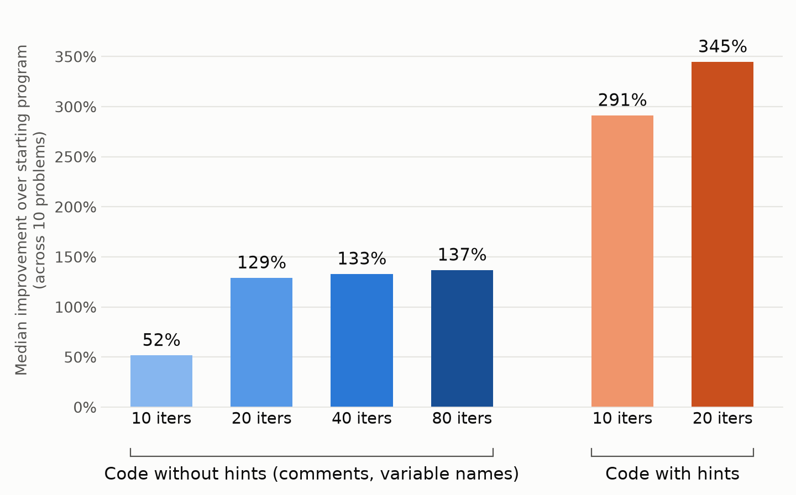

# openevolve-codehints

Do comments and variable names help LLM-driven code evolution? This repository has the code, problems, run data and analysis for a study using [OpenEvolve](https://github.com/algorithmicsuperintelligence/openevolve) with Claude Opus 5.5 on ten optimisation problems.

**Result:** on problems built so that the code alone does not reveal the true objective, programs with comments explaining the goal beat the same programs without them on all ten problems. With hints, the median improvement over the starting program was 291% after 10 iterations. Without hints it was 137% after 80 iterations. Telling the model that the code was obfuscated did not help.



The full write-up is [REPORT.md](REPORT.md).

## Layout

| Path | Contents |
|---|---|
| `REPORT.md` | Goals, method, findings, limitations |
| `common/` | Shared harness, gate checks, run scripts, analysis and plotting scripts, and `PROBLEM_SPEC.md` (the protocol every problem follows) |
| `p01_…` to `p10_…` | One folder per problem, each holding:<br>• `task.py`, the scoring rule<br>• `baseline/` and `hinted/` starting programs<br>• both evaluators<br>• the reference solver and solutions<br>• saved blindness and memory checks in `checks/` |
| `config.yaml`, `config_notice.yaml` | OpenEvolve settings for the main arms and for the obfuscation-notice arm |
| `runs*/` | One folder per run, each holding its log, per-seed config and best program |
| `pilots/` | The two circle-packing pilot experiments |
| `figures/` | Charts and the CSV behind each one |

Paths inside logs and configs have been replaced with `<STUDY>` (this repository) and `<OPENEVOLVE>` (the OpenEvolve checkout). OpenEvolve checkpoints are not included; the analysis reads only the logs.

## Setup

These steps need Python 3.10 or later.

```bash
git clone https://github.com/algorithmicsuperintelligence/openevolve.git
cd openevolve && git checkout 3e72b5b && pip install -e . && cd ..
pip install scipy matplotlib
git clone https://github.com/ratulm/openevolve-codehints.git
cd openevolve-codehints
```

## Reproducing the analysis (no model access needed)

Run these from the repository root:

```bash
python common/check_problem.py p01_circles_lshape   # offline gates for one problem
python common/summarize_budgets.py                   # every arm at every budget, with paired tests
python common/plot_overall.py                        # figures/overall_median.png
python common/plot_bars.py per_problem_six_arms      # figures/per_problem_six_arms.png
```

These scripts regenerate the tables in `REPORT.md` and the charts in `figures/` from the logs in `runs*/`.

## Rerunning the experiments

Rerunning needs:

- [Claude Code](https://claude.com/claude-code) installed and authenticated with access to Claude Opus 5.5, either through an Anthropic account or through Amazon Bedrock (set `CLAUDE_CODE_USE_BEDROCK=1` plus your AWS profile and region);
- `zsh`, which the run scripts use;
- two environment variables:

```bash
export OPENEVOLVE_ROOT=/path/to/openevolve   # the checkout from Setup
export PYTHON=python                          # the interpreter with OpenEvolve installed
```

Then, for example:

```bash
common/run_one.sh p04_flat_basin baseline 1   # one blind run, seed 1, 20 iterations
common/run_one.sh p04_flat_basin hinted 1     # the matching hinted run
python common/llm_checks.py p04_flat_basin 3  # blindness and memory checks
```

Reruns write to the same `runs*/` folders as the published data, so they replace it. Work on a copy if you want to keep the original runs.

| Script | What it runs |
|---|---|
| `common/run_one.sh` | Main runs, 20 iterations |
| `common/run_ext.sh`, `common/run_ext80.sh` | Extend blind runs to 40 and 80 iterations from their checkpoints |
| `common/run_notice.sh`, `common/run_notice_ext.sh` | The obfuscation-notice arm |

The extension scripts resume from checkpoints, which are not in this repository, so they work only on runs you produce yourself.

**Cost.** The full study made about 6,000 Opus calls, including the extensions and the notice experiment. One representative call cost about $0.20, so a complete rerun is on the order of $1,000. LLM outputs are not deterministic, so individual runs will differ from the published ones.

## Licence

Apache-2.0, the same as OpenEvolve. See [LICENSE](LICENSE).
