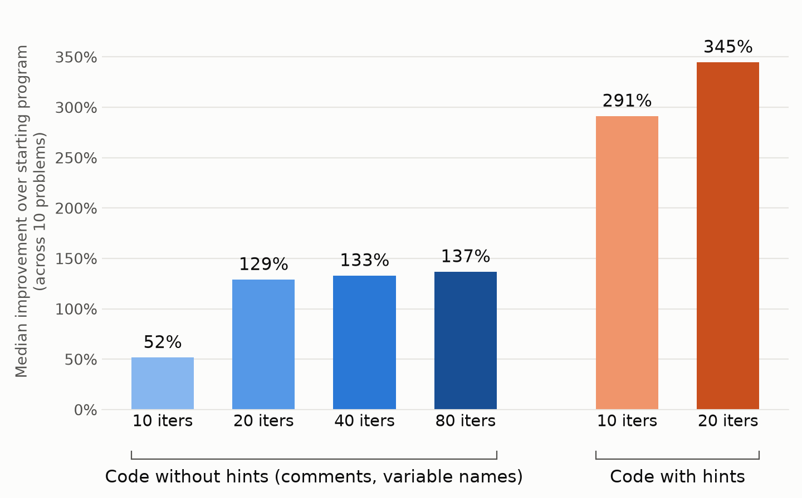
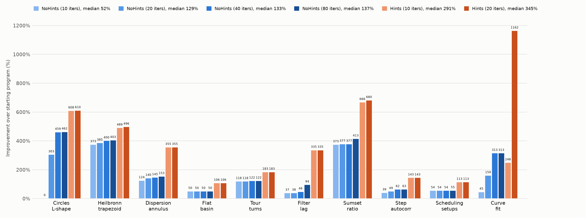
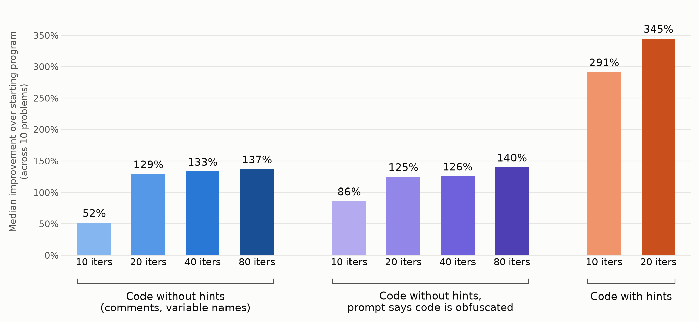

# Do hints in code help LLM-driven code evolution?

A study with OpenEvolve and Claude Opus 5.5 on ten non-standard optimisation problems.

## Summary

OpenEvolve improves a program by repeatedly asking an LLM to modify it and keeping the versions that score better. We asked whether it matters if the program explains itself: comments stating the goal and the scoring rule, descriptive names, and evaluator error messages that say why a candidate failed.

On ten problems constructed so that the code alone does not reveal the true objective, it matters a great deal.

- **Hinted programs beat blind programs on all ten problems.** This held when the hinted arm had 20 iterations and the blind arm had 20, 40 or 80 (paired Wilcoxon signed-rank test across problems, p = 0.002 in each case).
- **The median improvement over the starting program was 345% with hints after 20 iterations,** against 129% without hints after 20 iterations and 137% after 80.
- **With only 10 iterations, the hinted arm (median 291%) still beat the blind arm at 80 iterations (median 137%)** on 9 of 10 problems.
- **More iterations barely helped the blind arm.** It mostly kept refining an answer to the problem it assumed, not the problem being scored.
- **Telling the model the code was obfuscated did not help either.** With that notice in the prompt, the blind arm reached a median of 140% after 80 iterations, no different from the plain blind arm (section 5).

On a standard benchmark whose objective the model already knows (circle packing), hints made no measurable difference. The effect depends on the hint carrying information the model cannot infer or recall.

## 1. Goals

1. Measure whether natural-language hints in the program being evolved (comments, identifier names, evaluator error messages) change how far OpenEvolve improves it within a fixed budget of iterations.
2. Measure whether extra iterations let a blind run catch up.
3. Isolate the information a hint carries, rather than its surface form, by making sure the blind arm cannot get the same information from its own code or from the model's memory.

## 2. Pilot experiments

The pilots shaped the main design.

**Pilot 1: standard circle packing.** This is the repository's 26-circle example, scored by sum of radii against the best published value of 2.635. Two models were tested: Fable 5.2 (80%) mixed with Haiku 4.5 (20%), and Opus 5.5 alone. Each had 3 seeds per arm, 20 iterations each. Both arms reached about 1.0 within one or two iterations, with no difference between hinted and blind runs. The blind runs' final programs were constrained optimisers of the kind the hint described, so the model recognised the well-known problem and recalled the method without being told.

**Pilot 2: a blinded variant.** This used 21 circles in an L-shaped region with a hidden position-weighted objective. With Opus 5.5:
- the blind arm produced invalid programs on 53 of 60 iterations, and its best runs plateaued at 0.79, the value of optimising plain sum of radii;
- the hinted arm, which included a suggested solving method, reached 1.0 within one or two iterations.

With Fable 5.2, the blind arm stayed valid but plateaued at the same 0.80.

**Lessons applied to the main study:**
- problems must be non-standard;
- blindness must be verified, not assumed;
- the hinted arm should carry task knowledge only, with no solving advice.

## 3. Method

### 3.1 Arms

Every problem has two starting programs that return identical output and score identically at iteration 0.

| | Blind ("NoHints") | Hinted ("Hints") |
|---|---|---|
| Comments | None, apart from the evolve-block markers | Goal, exact scoring formula and constants, every validity rule, time limit, and what the score is *not* |
| Identifiers | One or two letters (`f`, `g`, `p`, `q`); entry point `run` | Descriptive (`circle_centers`, `greedy_radii_without_overlap`) |
| Evaluator feedback | A single number (`combined_score`); 0 on any failure, no message | Same score, plus a specific error message on failure (for example "Circle 0 … overlaps the removed block") |
| Solving advice | None | None: no algorithms, libraries, strategies or TODOs |

### 3.2 Problems

Each problem takes a known family and changes both the instance and the scoring rule. The "standard objective" is what a knowledgeable reader would assume from the blind program. The last column shows the score of the best solution we could find for that standard objective, measured under the true rule. Every problem was required to keep this at or below 0.90, so that solving the assumed problem well still falls well short.

| # | Problem | True scoring rule (hidden from the blind arm) | Standard objective assumed | Its best solution scores |
|---|---|---|---|---|
| 1 | Circles, L-shape | 21 circles in the unit square minus [0.6, 1]²; maximise Σ rᵢ (0.2 + xᵢ)² | Maximise Σ rᵢ | 0.80 |
| 2 | Heilbronn, trapezoid | 13 points in a trapezoid; maximise (smallest triangle area)^0.25 × (median triangle area)^0.75 | Maximise the smallest triangle | 0.80 |
| 3 | Dispersion, annulus | 18 points in an annulus; maximise the minimum pairwise distance under an anisotropic, height-scaled metric | Euclidean max-min distance | 0.55 |
| 4 | Flat basin | One point in [-4, 4]³ for an invented function; minimise its mean over a 27-point neighbourhood | Global minimum of the function | 0.73 |
| 5 | Tour turns | Closed tour of 46 points; minimise length + 10 Σ (turning angle)² | Shortest tour | 0.70 |
| 6 | Filter lag | 24-tap causal filter applied to hidden signals; minimise tracking error + 8 × lag-after-jumps + 0.1 × roughness | Minimum mean squared error | 0.65 |
| 7 | Sumset ratio | Set A of up to 60 integers in 0..299; maximise \|A+A\|² / (\|A−A\| · \|A\|^1.5) | Maximise \|A+A\| / \|A−A\| | 0.53 |
| 8 | Step autocorrelation | 50 step heights; minimise max over shifts k of wₖ (a∗a)ₖ / (Σa)², with w rising linearly from 1 to 4 | Unweighted autoconvolution peak | 0.60 |
| 9 | Scheduling | 36 jobs on one machine; total weighted tardiness with a hidden setup of 3 between job families (index mod 4) | Weighted tardiness, no setups | 0.70 |
| 10 | Curve fit | Predict 50 query points from 80 noisy samples of an invented law; scored only on the 25 out-of-range queries, with under-prediction penalised 8× | Best fit to the training data | 0.31 |

Scores are normalised so that 1.0 is the best solution our own offline solver found for each problem (the "reference"). The references differ in strength:
- for filter lag the reference is the proven optimum, and for dispersion and autocorrelation it is very likely optimal;
- the hinted arm slightly beat it on circles and sumset;
- on curve fit the reference was built without knowing the hidden law and is deliberately beatable, so scores well above 1.0 occur.

For that reason the headline metric is **improvement over the starting program**, not the fraction of the reference reached.

### 3.3 Acceptance gates

Every problem had to pass all of these before any evolution run:

1. **Blind lint:** an automatic check that the blind program has no comments, docstrings or string literals, and no identifiers longer than two characters.
2. **Matched start:** both arms return identical output and the same score.
3. **Headroom:** the starting score is valid and at most 0.60.
4. **Offline gap:** the reference scores 1.0, and the standard-objective solution is valid, scores at most 0.90, and beats the start.
5. **Blindness check:** Opus 5.5 was shown the exact first-iteration prompt for each arm (3 samples) and asked what `combined_score` measures. It had to give the wrong objective for the blind arm and the right one for the hinted arm. In every accepted problem, the blind answers named the standard objective and the hinted answers stated the true formula.
6. **Memory check:** asked cold for the best known value of the true task (2 samples), Opus had to answer "unknown". It did for all ten.

Problem 10 initially failed gate 5: the model inferred from the data that extrapolation error was being scored. It was redesigned, with interleaved in-range and out-of-range queries and an asymmetric loss, and then passed.

### 3.4 Evolution settings

The settings were identical for every problem and arm.

- **Model:** Claude Opus 5.5 (`us.anthropic.claude-opus-5-5`) on Amazon Bedrock, through OpenEvolve's `claude_code` provider.
- **System message:** generic, with no task-specific content ("You are an expert programmer. Improve the given program so that it scores higher on the evaluation metrics.").
- **Evolution:** diff-based; 4 islands; population 60; archive 25; 3 programs shown in the prompt; 4 parallel evaluations; no cascade evaluation.
- **Isolation:** runs were launched from an empty directory, so the model could not read the repository, the evaluator or the reference solutions.
- **Replication:** 3 seeds per arm, using the same seed values (1, 2, 3) in both arms.
- **Budgets:**
  - Hinted runs: 20 iterations.
  - Blind runs: 20 iterations, then resumed from their checkpoints to 40 and to 80.
  - 10-iteration figures are taken from the first 10 iterations of the 20-iteration logs. This is valid because OpenEvolve dispatches iterations in order and each starts only from earlier results.

### 3.5 Analysis

- **Per-run metric:** best score within the first N iterations, never below the starting score.
- **Per-problem value:** the mean over the 3 seeds of 100 × (best − start) / start.
- **Summary across problems:** the median, chosen over the arithmetic mean because a few problems with low starting scores or the soft curve-fit reference dominate the mean. Geometric means of best ÷ start are given as a secondary average.
- **Significance:** a paired Wilcoxon signed-rank test on the ten per-problem differences.

## 4. Findings

### 4.1 Hints win on every problem

| Arm | Median | Geometric mean | Arithmetic mean |
|---|---|---|---|
| NoHints, 10 iterations | 52% | 93% | 121% |
| NoHints, 20 iterations | 129% | 139% | 167% |
| NoHints, 40 iterations | 133% | 164% | 203% |
| NoHints, 80 iterations | 137% | 175% | 213% |
| Hints, 10 iterations | 291% | 282% | 325% |
| Hints, 20 iterations | 345% | 336% | 418% |

| Comparison | Hints better on | Wilcoxon p |
|---|---|---|
| Hints 20 vs NoHints 20 | 10/10 | 0.002 |
| Hints 20 vs NoHints 40 | 10/10 | 0.002 |
| Hints 20 vs NoHints 80 | 10/10 | 0.002 |
| Hints 10 vs NoHints 20 | 10/10 | 0.002 |
| Hints 10 vs NoHints 40 | 9/10 | 0.014 |
| Hints 10 vs NoHints 80 | 9/10 | 0.014 |

The one exception (curve fit, Hints 10 vs NoHints 40 or 80) comes from a single blind seed, discussed in 4.4.

### 4.2 Scores by problem

The table shows the mean of 3 seeds, on the normalised scale where 1.0 is the reference.

| # | Problem | Start | NoHints 20 | NoHints 40 | NoHints 80 | Hints 10 | Hints 20 |
|---|---|---|---|---|---|---|---|
| 1 | Circles, L-shape | 0.143 | 0.577 | 0.800 | 0.804 | 1.013 | 1.016 |
| 2 | Heilbronn | 0.165 | 0.801 | 0.826 | 0.832 | 0.974 | 0.985 |
| 3 | Dispersion | 0.220 | 0.529 | 0.538 | 0.555 | 1.000 | 1.000 |
| 4 | Flat basin | 0.485 | 0.726 | 0.726 | 0.726 | 1.000 | 1.000 |
| 5 | Tour turns | 0.353 | 0.770 | 0.782 | 0.782 | 1.000 | 1.000 |
| 6 | Filter lag | 0.229 | 0.315 | 0.335 | 0.444 | 0.994 | 0.994 |
| 7 | Sumset ratio | 0.124 | 0.593 | 0.593 | 0.638 | 0.953 | 0.970 |
| 8 | Step autocorr | 0.411 | 0.613 | 0.668 | 0.668 | 1.000 | 1.000 |
| 9 | Scheduling | 0.470 | 0.723 | 0.723 | 0.726 | 1.000 | 1.000 |
| 10 | Curve fit | 0.200 | 0.517 | 0.827 | 0.827 | 0.695 | 2.524 |

### 4.3 The hinted arm converges almost immediately

On seven problems the hinted arm was at its final score by iteration 10, and on most of them within the first few iterations. Heilbronn and sumset gained a further 1–2% between iterations 10 and 20. Curve fit was the exception: 0.695 at iteration 10 and 2.52 at iteration 20.

The hinted arm almost never produced an invalid program (3% on problem 1, 0% on most others).

### 4.4 The blind arm stalls on the problem it assumed

- **No movement:** on problems 4, 5 and 9 the blind arm found its final answer within the first 7 iterations of most runs and barely moved over the remaining 70 or more. Its best programs are competent optimisers of the standard objective. For example, the tour programs are 2-opt and Or-opt local search on tour length, with no turning logic, and the scheduling programs contain no setup logic.
- **Validity failures:** on problem 1, the blind arm produced invalid programs 88% of the time in its first 20 iterations, almost always by placing a circle inside the removed block. Its notch-handling code looked like a leftover, and the model dropped it. One seed produced no valid improvement until iteration 32. When the blind runs became valid, they landed at 0.80, the plain sum-of-radii optimum.
- **Partial rule discovery:**
  - On sumset, one seed jumped from 0.60 to 0.72 at iteration 72 by building small symmetric sets and pruning elements. That is the structure the hidden size penalty rewards.
  - On filter lag, the blind arm kept improving through iteration 80 (0.32 to 0.44) by tuning a single filter-shape parameter against the score. The model recorded the scores it observed in comments, which is hill-climbing on feedback, not inference of the lag rule.
  - Both are far below the hinted arm.
- **Curve fit:** one blind seed jumped from 0.64 to 1.51 at iteration 21. It searched model forms by cross-validation and found a structure close to the hidden law. It made no use of the scoring rule (no asymmetry adjustment, no attention to which queries count). It beats the reference only because that reference is weak. The other two seeds stayed at 0.60 and 0.37.

Taken together, quadrupling the blind arm's budget from 20 to 80 iterations closed between 0% and 19% of the gap to the hinted arm on nine problems. The exception is circles (52%), where the gain came from the one seed that finally produced valid packings and stopped at the same 0.80 plateau as the others.

## 5. Additional experiment: telling the model the code is obfuscated

### 5.1 Question

Is the blind arm's shortfall a matter of effort or attention, which a prompt could fix, or of missing information? To test this, we told the model that the code had been deliberately obfuscated and asked it to study the program before optimising.

### 5.2 Method

We added a third arm, "NoHints + notice". It uses the same blind programs, blind evaluators, seeds and settings as the blind arm. The only difference is the system message, which gains a second paragraph:

> You are an expert programmer. Improve the given program so that it scores higher on the evaluation metrics.
>
> This program has been deliberately obfuscated (by removing comments, variable names, method names, etc.) to test how far you can improve it. You are under test. Before starting the optimization, study it closely and note down its structure, the meaning of each variable and function, and what the program computes.

The notice deliberately says nothing about the scoring, so it adds no information about the objective. The runs started fresh from the initial programs, ran for 10 iterations, and were then resumed from their checkpoints to 80. Results at 10, 20, 40 and 80 iterations come from the same runs.

### 5.3 Results

| Iterations | NoHints | NoHints + notice | Hints |
|---|---|---|---|
| 10 | 52% | 86% | 291% |
| 20 | 129% | 125% | 345% |
| 40 | 133% | 126% | |
| 80 | 137% | 140% | |

The table shows the median improvement over the starting program across the ten problems.

| Comparison | Result |
|---|---|
| Notice vs NoHints, same budget (10, 20, 40, 80) | Better on 4–5 and worse on 4–5 problems at every budget; Wilcoxon p = 0.50–0.82 |
| Hints at 10 vs Notice at any budget up to 80 | Hints better on 10/10; p = 0.002 |
| Hints at 20 vs Notice at any budget up to 80 | Hints better on 10/10; p = 0.002 |

The mean best score per problem after 80 iterations, on the normalised scale, was:

| # | Problem | NoHints @80 | Notice @80 | Hints @10 |
|---|---|---|---|---|
| 1 | Circles, L-shape | 0.804 | 0.822 | 1.013 |
| 2 | Heilbronn | 0.832 | 0.837 | 0.974 |
| 3 | Dispersion | 0.555 | 0.562 | 1.000 |
| 4 | Flat basin | 0.726 | 0.726 | 1.000 |
| 5 | Tour turns | 0.782 | 0.793 | 1.000 |
| 6 | Filter lag | 0.444 | 0.417 | 0.994 |
| 7 | Sumset ratio | 0.638 | 0.595 | 0.953 |
| 8 | Step autocorr | 0.668 | 0.654 | 1.000 |
| 9 | Scheduling | 0.726 | 0.722 | 1.000 |
| 10 | Curve fit | 0.827 | 0.519 | 0.695 |

### 5.4 Reading the results

- **No effect at any budget.** The notice arm's apparent lead at 10 iterations (86% against 52%) came mostly from two circle seeds that produced a valid packing early. The plain arm's seeds did the same by iteration 14, and the rate of invalid programs was identical (33 of about 300 in each arm). From 20 iterations on, the two arms track each other within a few points.
- **Same plateaus.** Both blind arms converge on the scores of the standard-objective solutions: about 0.80 on circles, 0.55–0.56 on dispersion, and 0.726 on flat basin. Studying the obfuscated code did not lead the model to the hidden scoring rules.
- **Curve fit is the only sizeable per-problem difference.** It comes from the single plain-arm seed that found a better model at iteration 21; no notice seed did.
- **The model's notes were not kept.** It wrote its analysis in its reply text, not in the code, and the evolved programs contain almost no new comments. Whatever it worked out in one iteration was therefore not carried forward to later ones.

### 5.5 Conclusion

Telling the model the code was obfuscated and asking it to study it first did not substitute for being told the goal. The blind arm is short of information about the objective, not of effort or care in reading the code.

## 6. Interpretation

Evolutionary search through an LLM optimises the problem the model *believes* it is solving. When the code does not reveal the objective, the model fills the gap with the most plausible standard objective. Score feedback alone, delivered as one number per candidate, rarely corrects that belief within 80 iterations. Asking the model to study the code more carefully does not correct it either (section 5).

A short comment stating the true objective and constraints removed the gap almost entirely and within 10 iterations, without any advice on how to solve the problem.

The circle-packing pilots mark the boundary of the effect. When the model already knows the task, hints have nothing to add.

## 7. Limitations

- **The problems were designed to hide information.** The study measures how well evolution recovers task knowledge the code withholds, not the value of hints on arbitrary code. The size of the effect partly reflects how far each twist sits from its standard version.
- **The hint is a bundle.** Goal, formula, rules, names and error messages were varied together, so the study does not say which part matters. Given how rarely either arm produced invalid programs outside problem 1, error messages probably contributed little.
- **One model, one framework, three seeds.** The cross-problem result is solid (10 of 10, p = 0.002); individual per-problem effects are estimates.
- **Unequal reference strength.** Normalised scores are not comparable in absolute terms across problems, which is why improvement over the start is the headline metric. That metric is itself scaled by how weak each starting program is, but the scaling is shared by both arms.
- **Problem 10 is weaker than the rest.** It was redesigned after failing the blindness check, its reference is soft, and its score is unbounded above, so it dominates arithmetic means.
- **Selection by the author.** The problem families were chosen by hand from the repository's examples plus two new ones, not sampled. The twists were proposed by the author and implemented and tuned by separate agents to pass the gates.
- **Agent-style mutation calls.** Each mutation was a Claude Code call that sometimes tried, and was refused permission, to run code. This applied equally to both arms.
- **Lost iterations.** A handful of iterations were lost to malformed diffs from the model. No run logged errors.

## 8. Suggested follow-ups

1. **Unbundle the hint** on the same ten problems: objective stated with neutral names; descriptive names with no objective; error messages only.
2. **Repeat with other models**, including a weaker one such as Haiku, to see whether the dependence on hints grows when the model is less able to infer the task.
3. **Vary feedback richness in the blind arm** (for example multiple metrics instead of one number) to see whether richer score feedback substitutes for comments.
4. **Make the model's understanding persist.** A variant of the notice could ask the model to write its reading of the code into the program as comments, so that inferences accumulate across iterations instead of being lost after each reply.

## 9. Reproduction

Everything is in this repository; see `README.md` for setup. Results were produced with OpenEvolve at commit `3e72b5b`. Run the commands below from the repository root.

| Path | Contents |
|---|---|
| `common/PROBLEM_SPEC.md` | The protocol every problem follows |
| `common/harness.py`, `lint_blind.py`, `check_problem.py`, `llm_checks.py` | Shared evaluator, blind lint, offline gates, blindness and memory checks |
| `p01_…` to `p10_…` | Each problem: `task.py` (scoring), both initial programs, both evaluators, reference solver and pickles, saved blindness and memory answers in `checks/` |
| `config.yaml` | Evolution settings |
| `config_notice.yaml` | Notice-arm settings: identical to `config.yaml` apart from the system message |
| `runs/` | Iterations 1–20, both arms |
| `runs_ext40/`, `runs_ext80/` | Blind arm, iterations 21–40 and 41–80 |
| `runs_notice/`, `runs_notice_ext80/` | Notice arm, iterations 1–10 and 11–80 |
| `pilots/` | The two circle-packing pilots |
| `figures/` | Charts and the CSV behind each one |

Each run folder keeps its log, its per-seed config and its best program. OpenEvolve's checkpoints (about 900 MB) are not included; the analysis needs only the logs.

| Command | Output |
|---|---|
| `python common/check_problem.py p01_circles_lshape` | Offline gates for one problem |
| `python common/summarize.py` | Per-problem results at 20 iterations |
| `python common/summarize_ext80.py` | Blind arm at 20, 40 and 80 iterations, compared with hinted |
| `python common/summarize_budgets.py` | All arms, including the notice arm, at every budget, with paired tests |
| `python common/plot_overall.py` | Overall median chart |
| `python common/plot_overall_notice.py` | Overall median chart with the notice arm |
| `python common/plot_bars.py per_problem_six_arms` | Per-problem chart |

**Approximate model usage:**
- Pilots: about 480 Opus and Fable calls.
- Main study: about 1,200 evolution calls at 20 iterations, plus 600 for the extension to 40 and 1,200 for the extension to 80.
- Notice experiment: about 2,400 calls (300 for the first 10 iterations, 2,100 for the extension to 80).
- Gate checks: about 100 calls.

Measured cost for one representative mutation call was about $0.20; total spend was not measured.
